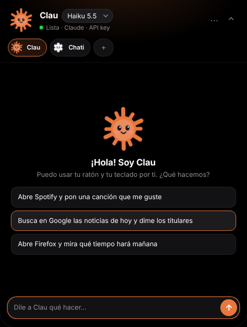
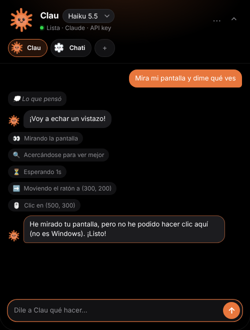
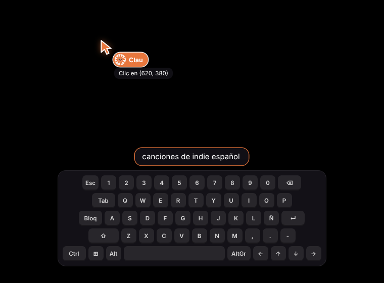

# Clean Assistant

Mini agentes de escritorio para **Windows**. Un **notch negro arriba en el centro** de la pantalla donde le pides cosas a **Clau** (Claude) o a **Chati** (ChatGPT), y ellos usan tu ordenador con su propio cursor de color mientras ves en pantalla lo que escriben.

> «Abre Spotify y pon una canción que me guste» · «Busca en Google las noticias de hoy» · «Abre Firefox y mira el tiempo»

No necesita APIs de desarrollador de Spotify ni extensiones del navegador: el agente **ve capturas de tu pantalla** y **mueve el ratón y pulsa teclas** como lo harías tú, así que funciona con cualquier programa.

<p>
  
  &nbsp;
  
</p>
<p>
  
  
</p>


## Qué hace

- **Notch arriba en el centro**, negro y opaco: recogido muestra al agente y su modelo; mientras trabaja se ensancha y enseña en directo lo que está haciendo, con un botón para pararlo. Haz clic y se despliega hacia abajo con el chat, el selector de agentes, el menú y los ajustes. Si haces clic fuera, se recoge solo.
- **Sonido** suave al abrir y cerrar el notch (con volumen ajustable o desactivable).
- **Varias pantallas**: detecta tus monitores y el agente puede trabajar en cualquiera de ellos dentro de la misma tarea, saltando de uno a otro (el cursor y el brillo del borde se mueven con él). Hay un solo ratón y un solo teclado, así que hace las cosas en una pantalla cada vez, no en dos a la vez.
- **Elige el modelo** de cada agente: Opus 5.5, Sonnet 5.5 o Haiku 5.5, tanto con API key como con la suscripción. Se cambia en un clic desde la cabecera del notch. Con la suscripción, **Haiku 5.5 es el que menos límite gasta**.
- **Cursor del agente**: un puntero naranja (Claude) o blanco brillante (ChatGPT) con su nombre, que se desliza hasta donde va a hacer clic, con ondas al hacer clic y un borde brillante en la pantalla mientras trabaja.
- **Teclado digital** en pantalla que ilumina las teclas y muestra en tiempo real lo que el agente va escribiendo.
- **Ves lo que piensa**: el razonamiento resumido, sus mensajes y cada acción («Clic en…», «Escribiendo…») aparecen en directo en el chat.
- **Mascotas**: una estrellita naranja y un nudito blanco con carita, que parpadean y se animan al trabajar. Puedes ponerle a cada agente la imagen que quieras.
- **Agentes configurables**: crea los que quieras, cada uno con su nombre, cerebro (proveedor), modelo, color, mascota, nivel de esfuerzo y personalidad.
- **«Sobre ti»**: cuéntales tus gustos (música, apps que usas, ciudad) para que lo personalicen.

## Cerebros (cómo se conecta a tu cuenta)

| Cerebro | Qué necesitas | Estado |
|---|---|---|
| **Claude · API key** | Una API key de Anthropic ([console.anthropic.com](https://console.anthropic.com/settings/keys)). Se paga por uso, aparte de la suscripción. | Recomendado. Usa el toolset oficial de *computer use* (`claude-opus-5-5` por defecto). |
| **Claude · suscripción (Claude Code)** | Tener [Claude Code](https://code.claude.com) instalado y con la sesión de tu cuenta Pro/Max iniciada. | **Sin API key.** Funciona por el CLI oficial: la app le da herramientas de pantalla, ratón y teclado mediante un servidor MCP local. Es el cerebro por defecto de Clau (con Haiku 5.5). |
| **ChatGPT · API key** | Una API key de OpenAI ([platform.openai.com](https://platform.openai.com/api-keys)). Pago por uso. | Usa la herramienta `computer` de la Responses API (`gpt-5.5` por defecto; cámbialo si tu cuenta usa otro modelo con esa herramienta). |
| **ChatGPT · suscripción (Codex CLI)** | Tener [Codex CLI](https://github.com/openai/codex) instalado y con la sesión iniciada (`codex login`). | **Experimental**: depende de que tu versión de Codex pase las imágenes de las herramientas MCP al modelo. |

**Sin suscripción y sin API key no hay forma legítima de usarlo.** Automatizar la web de ChatGPT o de Claude incumple sus términos y se rompe a menudo, así que la app no lo hace.

Las API keys se guardan **cifradas con DPAPI** (ligadas a tu usuario de Windows) y nunca se envían a la interfaz. Si no hay ninguna guardada, se usan las variables de entorno `ANTHROPIC_API_KEY` / `OPENAI_API_KEY`.

## Instalación

Descarga `Clean-Assistant-Setup-x.y.z.exe` y ábrelo. El asistente te deja elegir la carpeta y crea accesos directos en el escritorio y en el menú Inicio. Se desinstala desde *Configuración → Aplicaciones*.

> El instalador no está firmado con un certificado de pago, así que Windows SmartScreen mostrará «Windows protegió su PC». Pulsa **Más información → Ejecutar de todas formas**.

Para generar el instalador en GitHub sin tener nada instalado: pestaña **Actions → Instalador de Windows → Run workflow**, y descarga el `.exe` desde los artefactos. Si subes una etiqueta `v*`, se publica además como *release*.

## Desarrollo

Requisitos: Windows 10 (2004 o posterior) u 11, y [Node.js 20+](https://nodejs.org).

```bash
npm install
```

```bash
npm start
```

Para generar el instalador (`release/Clean-Assistant-Setup-x.y.z.exe`):

```bash
npm run dist
```

## Uso

1. Abre **⋯ → Ajustes** y pega tu API key, o comprueba que Claude Code / Codex están instalados.
2. Haz clic en el notch, elige agente (Clau, Chati o los tuyos) y modelo en la cabecera.
3. Escribe lo que quieres y pulsa Enter. Puedes recoger el notch: seguirás viendo qué hace.
4. Para pararlo: el botón ■ del notch, **Detener** en el chat o el atajo global **Ctrl+Alt+Q** (configurable). También desde el icono de la bandeja.

## Seguridad: léelo

Darle a una IA el control de tu ratón y tu teclado tiene riesgos reales:

- **Puede equivocarse**: hacer clic donde no toca, escribir en la ventana equivocada o tardar. Cada paso es una captura más una llamada al modelo (unos segundos por paso).
- **Inyección de instrucciones**: una web o un correo puede contener texto pensado para engañar al agente. El prompt le ordena tratar lo que hay en pantalla como datos, no como órdenes, pero eso no es infalible.
- Por eso el agente tiene orden de **parar y preguntarte** antes de comprar, enviar mensajes, borrar o cambiar ajustes de cuentas, y de **no escribir nunca contraseñas ni datos de tarjeta**.
- Por defecto trabaja en modo **autónomo** (más cómodo). En **Ajustes → Seguridad** puedes hacer que te pida permiso antes de escribir o pulsar teclas, o antes de cada acción.
- Si OpenAI marca una acción como sensible (`pending_safety_checks`), la app **siempre** te pide confirmación.
- Mientras trabaja, **no toques el ratón**: hay un solo puntero real. Con «Devolverte el ratón» activado, tu puntero vuelve a su sitio después de cada clic del agente, pero si lo mueves a la vez os estorbaréis.
- Las capturas de pantalla se envían al proveedor del agente (Anthropic u OpenAI). No lo uses con información que no quieras compartir con ellos.

## Cómo funciona

```
src/
  main/
    main.ts            Ventanas (widget + capa), bandeja, IPC, atajo global de parada
    desktop.ts         Acciones normalizadas → animación del cursor + entrada real + confirmaciones
    input/             Helper Win32 (SendInput) en C# compilado por PowerShell: sin módulos nativos
    screen-capture.ts  Capturas (desktopCapturer), escalado y conversión de coordenadas (DPI)
    settings.ts        Ajustes en JSON y claves cifradas con safeStorage
    agents/
      anthropic.ts     Bucle con el toolset computer_toolset_20260801 de Claude
      openai.ts        Bucle con la herramienta computer de la Responses API
      cli.ts           Claude Code / Codex CLI + servidor HTTP local para el puente MCP
      runner.ts        Una tarea a la vez, parada, historial por agente
  mcp-bridge/          Servidor MCP por stdio que reenvía las herramientas a la app
  renderer/widget/     Interfaz del chat (TypeScript sin framework)
  renderer/overlay/    Cursor del agente, ondas de clic y teclado digital
```

- Las capturas se reducen a 1568 px de lado mayor (configurable) y las coordenadas del modelo se convierten a píxeles físicos, así que funciona con escalado de Windows al 125 %, 150 %, etc.
- La capa del cursor deja pasar los clics y se excluye de las capturas (`WDA_EXCLUDEFROMCAPTURE`), así que el agente no ve su propio cursor. El chat sí aparece en las capturas a propósito, para que el agente no haga clic encima.

## Limitaciones conocidas

- **Solo Windows.** El notch está siempre en la pantalla principal.
- El notch tapa una franja pequeña arriba en el centro (donde a veces están las pestañas del navegador). El agente lo ve en sus capturas y lo esquiva, pero si una pestaña queda justo debajo, tendrá que usar atajos de teclado.
- **Un agente a la vez**: dos agentes con un solo ratón real se pelearían.
- Las apps que se ejecutan como administrador no aceptan clics de una app sin privilegios (lo impide Windows). Tampoco funciona sobre la pantalla de bloqueo ni sobre los avisos de UAC.
- Las mascotas son diseños propios **inspirados** en los logos, no los logos oficiales (son marcas registradas). Si es para tu uso personal, puedes subir el icono que quieras en el editor de cada agente.
